# Welding Sequence Analysis

This repository was developed as part of the **Data Science 2** course at **Hochschule Hannover (University of Applied Sciences and Arts)**.

## Overview

The dataset consists of **14** daily Parquet files containing **63** features. The objective of this project is to identify patterns and similarities between welding sequences using dimensionality reduction and unsupervised clustering.

Consecutive time intervals during which the `Schweißen EIN` (welding ON) signal is active are grouped into individual welding sequences, resulting in **383** sequences.

## Data overview

Each Parquet file holds one day of machine data (timestamp resolution: milliseconds). Column names follow the pattern `[<PLC id>:<index>] <German description> (<PLC address>)`. The columns are grouped below with English translations. `Schweißen EIN` is the signal used to cut the recording into sequences. It is not used as a feature.

| Group | Columns | Type | Examples (German → English) |
|---|---|---|---|
| Time | 1 | timestamp | `Time` → timestamp |
| Supply / welding electrical | 8 | float | `Einspeisung L1 Strom Istwert` → supply L1 current (actual) |
| Welding current control | ~20 | float | `Schweißstromregelung: Reglerausgang` → welding current control: controller output |
| Smoothing pressure control | ~7 | float | `Glättdruckregelung: Druckistwert Glättrollen` → smoothing pressure control: actual pressure of smoothing rollers |
| Table adjustment | ~10 | float | `Tischverstellung Überlapptisch Überlappung Istwert` → overlap table adjustment: overlap (actual) |
| Strip / material data | 8 | float | `Dicke Band Einlauf` → strip thickness (inlet) |
| Pressure / hydraulics | ~6 | float | `Istwert Luftdruck am Schweißrollenzylinder` → actual air pressure at the welding roller cylinder |
| Setpoints (HMI) | 4 | float | `MP377: Schweißkraft Sollwert` → HMI: welding force setpoint |
| Drive | 2 | float | `Antrieb C-Wagen Istposition in mm` → C-carriage drive actual position (mm) |
| Binary signals | 7 | bool | `Schweißen EIN` → welding ON |

The group sizes marked `~` are approximate. The exact list is available in the notebook via `schema`.

### German–English glossary

| German | English |
|---|---|
| Schweißen / Schweißmaschine | welding / welding machine |
| Schweißen EIN | welding ON |
| Schweißstrom | welding current |
| Schweißspannung | welding voltage |
| Schweißkraft | welding force |
| Schweißgeschwindigkeit | welding speed |
| Schweißrolle(n) / Schweißrollendruck | welding roller(s) / welding roller pressure |
| Einspeisung | supply (mains feed) |
| Strom / Spannung | current / voltage |
| Istwert | actual value |
| Sollwert | setpoint (target value) |
| Grundsollwert | base setpoint |
| skaliert / normiert | scaled / normalised |
| Regler / Reglerausgang | controller / controller output |
| Reglerdifferenz | control error (setpoint minus actual) |
| Reglerfreigabe | controller enable |
| I-Anteil / P-Anteil | integral / proportional component |
| Schweißstromregelung | welding current control |
| Glättrolle / Glättkraft | smoothing roller / smoothing force |
| Glättdruckregelung | smoothing pressure control |
| Druck / Luftdruck | pressure / air pressure |
| Druckregelventil / Prop_-Ventil | pressure control valve / proportional valve |
| Netz | (air) supply network |
| Stromschiene oben | busbar, top |
| Temperatur Start Schweißen | temperature at start of welding |
| Shunt / HKS | shunt / HKS (measurement point of the secondary circuit, as labelled in the data) |
| Zuführung / Rückführung | feed / return |
| Differenz | difference |
| Antrieb | drive |
| C-Wagen | C-carriage |
| Istposition | actual position |
| V-Ist | actual velocity |
| Tischverstellung | table adjustment |
| Überlapptisch / Kipptisch | overlap table / tilting table |
| Ausspannlänge | free clamping length (stick-out) |
| Überlappung | overlap |
| Schränkung | offset (lateral misalignment of strip edges) |
| Hydraulikzylinder Kolbenseite / Flächenseite | hydraulic cylinder, piston side / cap side |
| Druckmessung | pressure measurement |
| Band Einlauf / Auslauf | strip inlet / outlet |
| Dicke / Breite | thickness / width |
| Materialnummer | material number |
| Kohlenstoffgehalt | carbon content |
| ist unten / ist auf / ist ab | is down / is on / is off |
| Softwareschalter | software switch |
| Geschweißt Relais | "welded" relay |
| Glaettrolle ist auf SBE / ab SE | smoothing roller is at strip start (SBE) / at strip end (SE) |

Some translations (`HKS`, `Schränkung`, `SBE`/`SE`) are my best interpretation and should be checked against the machine documentation.

## Methodology

1. **Sequence extraction**: Identify welding sequences using the binary `Schweißen EIN`  signal. Consecutive active intervals are treated as one continuous welding sequence.
2. **Standardisation**: Apply z-score standardisation to all numerical features and remove constant features. 
3. **Common representation**: Resample each welding sequence using linear interpolation to obtain a fixed-length representation of (N = 300) equidistant time points.
4. **Dimensionality reduction**: Apply Principal Component Analysis (PCA) to the resulting data. Retain enough principal components to explain at least **95%** of the total variance, resulting in **160** components.
5. **Clustering**: K-Means on the reduced data. The elbow method estimates `k`, and `k = 2, 3, 4` are compared.
6. **Non-linear embedding**: Apply t-SNE (`perplexity = 30`) and UMAP (`n_neighbors = 15`, `min_dist = 0.1`) to the PCA-reduced data and colour the points with the K-Means clusters (`k = 3`) for comparison with the PCA projection.
7. **Comparison of clustering methods**: Hierarchical clustering (Ward linkage) and DBSCAN (`eps` from the k-distance plot) are compared with K-Means using the adjusted Rand index and silhouette score.
8. **Inspection**: Examine the original and interpolated signals of the nearest and farthest sequence pairs in PCA space, as well as a potential outlier.

## Results

### Next steps

<<<<<<< HEAD
160 principal components are needed to explain at least 95% of the total variance of the 383 resampled sequences, so the variance is spread over many components. Projected onto PC1 and PC2, the sequences form two well-separated groups (PC1 < 0 and PC1 > 0). The right-hand group has more internal structure and splits into an upper and a lower part along PC2.

| Cumulative explained variance | Sequences in PC1 / PC2 |
|---|---|
| 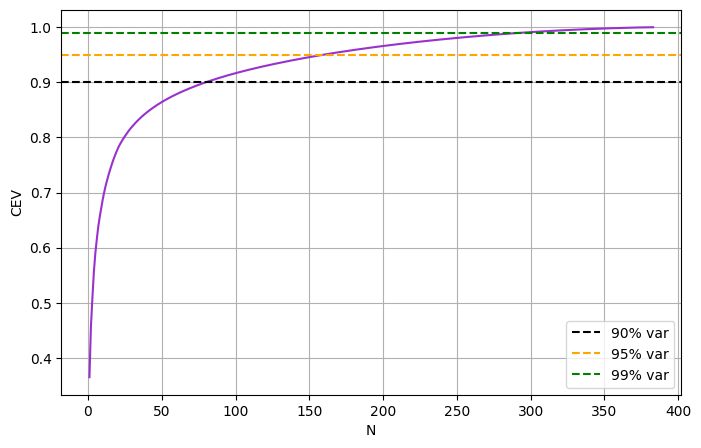 | 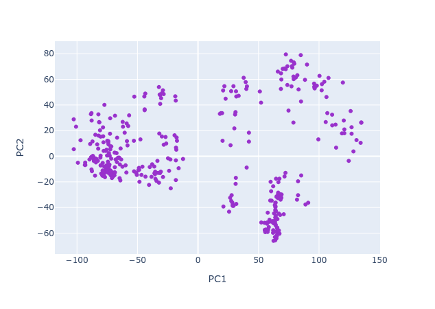 |

### Clustering

K-Means (`n_init = 50`) was fitted on the 160 principal components. The plots below show the clusters in the PC1 / PC2 plane.

**Elbow method.** The inertia drops sharply from k = 1 to k = 2 (to about 66% of the k = 1 value) and flattens out after k = 3 (about 58%). There is no pronounced elbow beyond k = 2, so the data does not indicate a single clearly correct `k`.

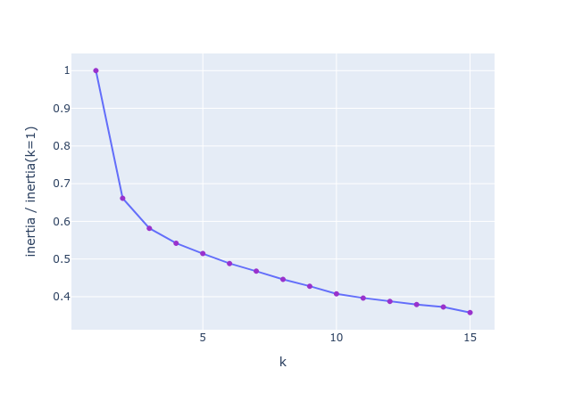

**Comparison of k = 2, 3, 4.**

| k | What the clusters capture |
|---|---|
| 2 | Separates the left group (PC1 < 0) from the right group (PC1 > 0). This matches the main structure in the PCA plot. |
| 3 | Splits the right group into an upper and a lower cluster along PC2. The left group stays intact. |
| 4 | Additionally splits the left group into two clusters. These are less clearly separated than the other splits. |

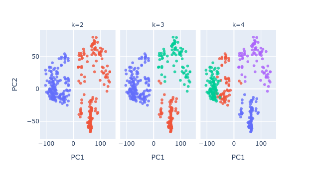

`k = 2` is the most clearly supported split. `k = 3` adds a split that is also visible in the PCA plot. `k = 4` mainly divides a group that looks continuous.

### Non-linear embeddings (t-SNE and UMAP)

Both embeddings were computed on the 160 principal components and coloured with the K-Means clusters (`k = 3`).

| t-SNE | UMAP |
|---|---|
| 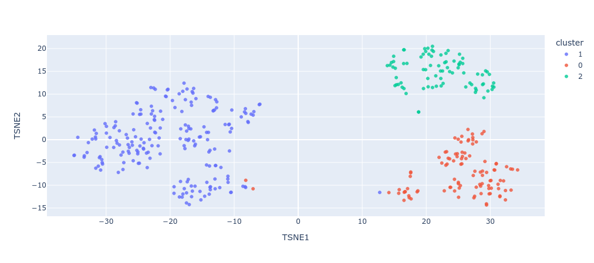 | 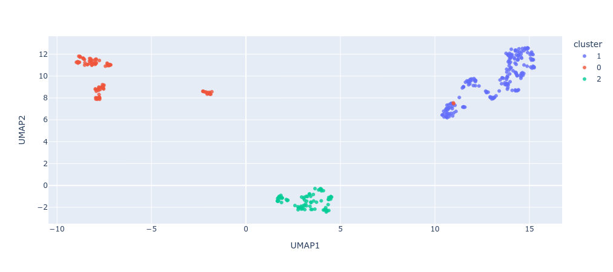 |

- t-SNE and UMAP show the same three-way structure as the PCA plot, so the groups are not an artefact of one method.
- UMAP shows three separate islands that match the three K-Means clusters: a large elongated group (PC1 < 0 in PCA), a compact group (upper right in PCA) and a small group made of a few sub-islands (lower right in PCA).
- Distances between islands and island sizes are not meaningful in t-SNE and UMAP. Only local neighbourhoods are.
- Only one parameter setting was used for each method, so the stability of the structure has not been tested yet.

### Comparison of clustering methods

Hierarchical clustering (Ward linkage, cut at 3 clusters) and DBSCAN were compared with K-Means (`k = 3`).

| Pair | Adjusted Rand index |
|---|---|
| K-Means vs hierarchical | 0.974 |
| K-Means vs DBSCAN | 0.043 |
| Hierarchical vs DBSCAN | 0.036 |

| Method | Silhouette score |
|---|---|
| K-Means | 0.287 |
| Hierarchical | 0.280 |
| DBSCAN (without noise points) | 0.005 |

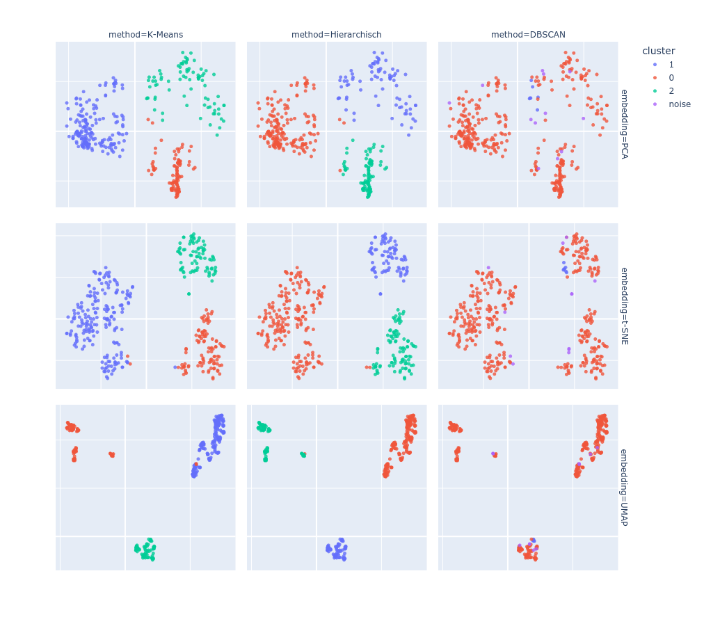

**Hierarchical clustering.** The dendrogram has one large merge at the top (two main groups), and the right branch splits again at a clearly larger distance than the splits below it. Cutting at 3 clusters is therefore consistent with the dendrogram, and the result is almost identical to K-Means.

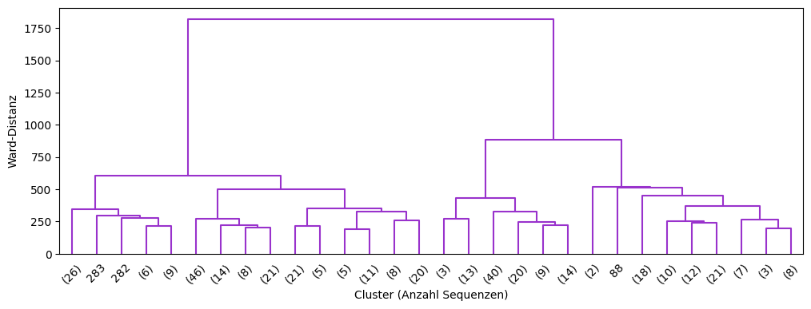

**DBSCAN.** With `min_samples = 5` and `eps = 98.77` (90th percentile of the k-distances), DBSCAN finds 2 clusters and 12 noise points. In practice almost all sequences fall into one cluster. The k-distance plot is flat up to about 100 and rises sharply only for the last ~10 points, so the density is roughly uniform and there are no density gaps between the groups. The groups are separated by distance, not by density, which makes DBSCAN a poor fit here. The k-distance plot and the dendrogram (singleton leaves such as sequences 282, 283 and 88) do agree on a small number of isolated sequences.

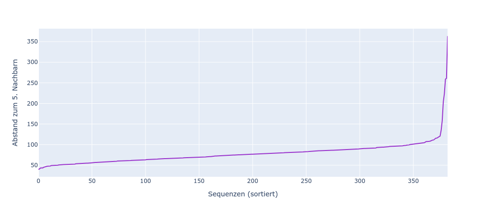

### Inspection of selected sequences

Sequences were selected in the PC1 / PC2 plane:

- **Nearest pair**: the two sequences with the smallest distance.
- **Farthest pair**: the two sequences with the largest distance.
- **Outlier**: the sequence with the largest mean distance to its four nearest neighbours.

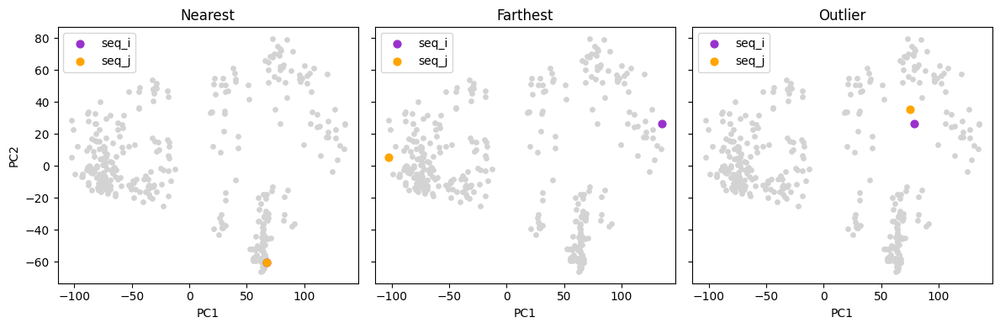

| Case | Observation |
|------|-------------|
| Nearest pair | Very similar signal shapes, so proximity in PCA space matches similarity in the raw time series. |
| Farthest pair | Clearly different signal height and duration. |
| Outlier | Hardly any difference in the inspected feature. Its position is probably driven by other features, which would have to be examined to confirm this. |

Nearest pair:

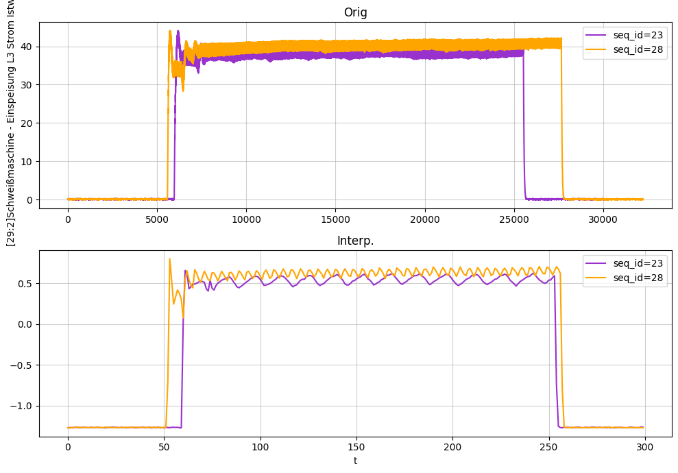

Farthest pair:

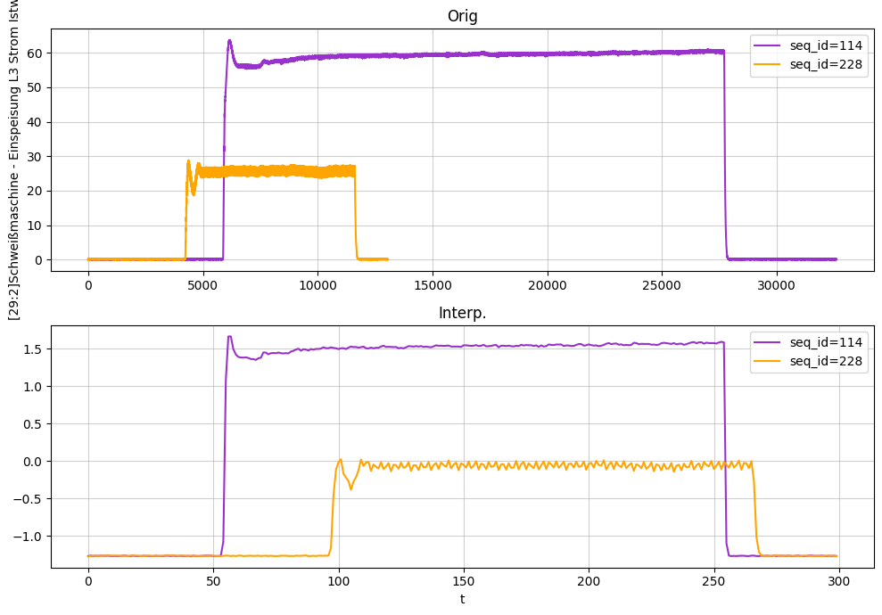

Outlier:

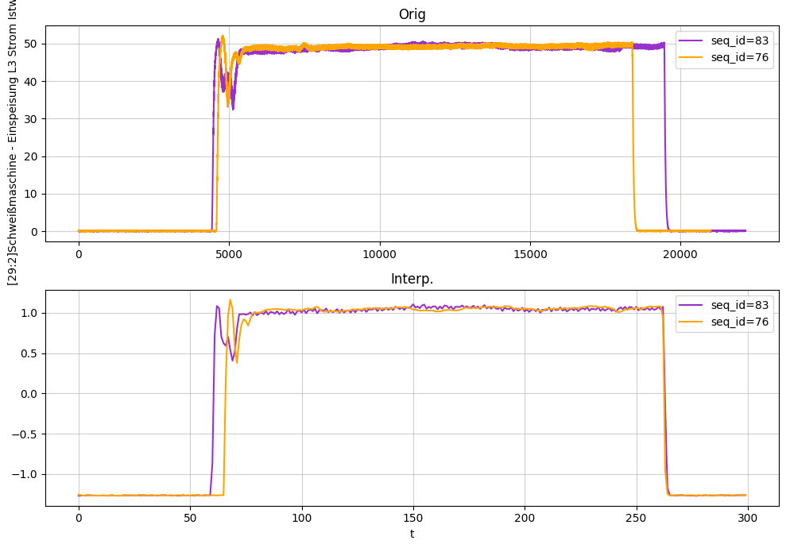

### Conclusions

- The welding sequences fall into three groups that are stable across PCA, t-SNE, UMAP, K-Means and hierarchical clustering. The main split into two groups is the strongest one, and the third group splits the right-hand group.
- K-Means and hierarchical clustering agree almost perfectly (adjusted Rand index 0.974), so the clusters do not depend on the algorithm.
- The separation is moderate, not sharp: silhouette scores are about 0.28 and the elbow plot has no pronounced elbow beyond `k = 2`. The choice of `k` is partly a judgement call.
- DBSCAN does not find the groups, because they are not separated by density gaps. It does flag a small number of isolated sequences.
- Distances in PCA space reflect real differences in the original signals, as the nearest and farthest pairs show.
- The outlier chosen in PC1 / PC2 is not explained by the single feature inspected, so a multi-feature comparison is needed.

### Limitations and next steps

- The clusters are not yet interpreted in terms of welding parameters. Cluster-mean signal profiles and PCA loadings would show what drives them.
- The clusters have not been checked against the recording day, material number, strip thickness or sequence duration. Any of these could explain the groups instead of different welding behaviour.
- Silhouette scores were computed for `k = 3` only. A scan over `k = 2..10` is still needed to compare `k` objectively.
- t-SNE and UMAP were run with a single parameter setting. Varying `perplexity` and `n_neighbors` would show how stable the structure is.
- DBSCAN was run on 160 dimensions, where distances become less informative. It could be repeated on a lower-dimensional embedding.
- Only one feature was plotted for the inspected pairs. The isolated sequences found by DBSCAN and the dendrogram (e.g. 282, 283, 88) should be compared with the outlier chosen in PCA space.
=======
- Evaluate t-SNE and UMAP as alternatives to PCA to investigate whether they reveal additional structures, local similarities, or clusters within the welding sequences.
- Examine the original and interpolated signals of the nearest and farthest sequence pairs in PCA space, as well as a potential outlier.
- Use the silhouette score alongside the elbow method.
>>>>>>> 23ba3f1ae0badfa0b07cae7d79e0300419560735
